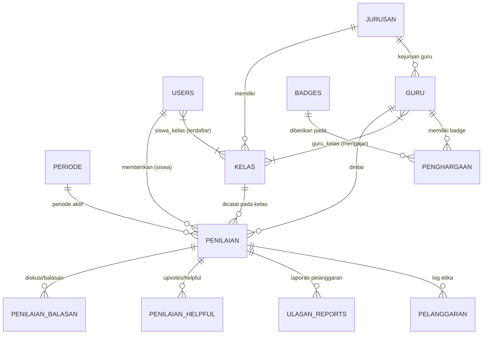

# 📘 Dokumentasi Arsitektur & Spesifikasi Lengkap Sistem GuruKuu

> ### ⚠️ PANDUAN MUTLAK UNTUK AI & DEVELOPER BARU (OPERATING DIRECTIVE)
> Dokumen ini adalah **Source of Truth (Sumber Kebenaran Tunggal)** dari seluruh arsitektur sistem GuruKuu.
> Setiap AI atau pengembang baru yang menangani proyek ini **WAJIB MEMATUHI PROTOKOL BERIKUT**:
>
> 1. **BACA DAHULU SEBELUM MENGUBAH APAPUN:** Jangan pernah mengubah kode, database, atau tampilan UI tanpa membaca bagian terkait di dokumen ini terlebih dahulu agar Anda memahami seluruh rantai ketergantungan sistem.
> 2. **KEWAJIBAN MEMPERBARUI DOKUMEN INI (*LIVING DOCUMENTATION*):** Jika Anda diminta melakukan revisi, menambah fitur baru, mengubah rumus, atau menambah tabel/kolom database, Anda **WAJIB langsung memperbarui file ini** agar AI atau developer berikutnya selalu mendapatkan informasi terkini.
> 3. **KEAMANAN KODE & ZERO SIDE EFFECTS:** 
>    * Dilarang keras merusak relasi dan aturan evaluasi: **Siswa hanya boleh menilai guru yang mengajar di kelasnya (`guru_kelas`)**.
>    * Dilarang merusak tampilan Desktop ketika sedang memperbaiki tampilan Mobile (dan sebaliknya).
>    * Pertahankan warna identitas brand utama: Navy Blue (`#003366`) dan Amber/Orange (`#ff6600`).
> 4. **EFISIENSI & MINIMAL BUG:** Bekerja cepat, tuntas, tanpa penjelasan bertele-tele di respons chat (ikuti [AGENTS.md](file:///c:/Users/ADVAN/PROJEK/Laravel/GuruKuu/AGENTS.md)).

---

## 1. Ringkasan Eksekutif & Tujuan Sistem
**GuruKuu** adalah platform web evaluasi kinerja dan apresiasi guru berbasis sekolah yang memungkinkan siswa memberikan penilaian objektif, umpan balik anonim yang aman, serta penghargaan berbasis reputasi (*leaderboard* & *badges*).

### Nilai Utama Sistem:
1. **Objektivitas & Keadilan:** Siswa hanya dapat menilai guru yang benar-benar mengajar di kelasnya.
2. **Anonimitas yang Terlindungi & Beretika:** Identitas siswa disamarkan (*anonim*), namun setiap kata kasar/toxic secara otomatis dideteksi dan dicatat di audit log pelanggaran admin.
3. **Dukungan Dua Sisi (Guru & Siswa):** Guru dapat menanggapi ulasan siswa secara edukatif dalam thread diskusi tertutup atau publik.
4. **Akurasi Data Sekolah:** Terintegrasi penuh dengan sistem induk sekolah (**SiPintu**) via OAuth SSO dan sinkronisasi data guru, siswa, kelas, serta jadwal.

---

## 2. Arsitektur Teknologi (*Tech Stack*)

| Lapisan | Teknologi / Pustaka | Keterangan |
| :--- | :--- | :--- |
| **Backend Framework** | Laravel 11 / PHP 8.3+ | Arsitektur MVC, Eloquent ORM, Middleware Pipelines, Artisan CLI |
| **Database** | MySQL / MariaDB | Relasi relasional dengan foreign keys, cascading deletes, dan index query |
| **Frontend Rendering** | Blade Templating Engine | Server-Side Rendering (SSR) modular berbasis layout & partials |
| **CSS Framework** | Bootstrap 5.3 + Custom CSS System | Token kustom CSS (`resources/css/app.css`), tanpa ketergantungan utility tailwind |
| **Icons & Typography** | Bootstrap Icons + Inter Font | Tipografi Google Font Inter dengan hierarki keterbacaan tinggi |
| **Interaktivitas Frontend**| Vanilla JS (ES6+) + Alpine.js | Micro-interactions, polling chat/stream, modal handling, live filter |
| **Autentikasi & Sesi** | Laravel Session + Multi-Device Tracking | Audit IP, user agent, revoke device session, remember me |
| **Integrasi Eksternal** | OAuth 2.0 Client & REST API | Terhubung ke SSO dan Webhook/API SiPintu |

---

## 3. Skema Basis Data & Relasi Model Eloquent



### Penjelasan Model-Model Inti:

1. **`User` (`users`)**:
   * Menampung seluruh pengguna: Siswa, Guru, dan Admin.
   * Atribut penting: `nis` (NIS siswa / NIP guru), `nama`, `email`, `role` (`admin`, `guru`, `siswa`), `status_aktif`, `deactivated_until`, `deactivated_reason`.
   * Relasi: `kelas()` (via pivot `siswa_kelas`), `penilaian()`, `loginHistories()`.

2. **`Guru` (`guru`)**:
   * Data master profil pengajar.
   * Atribut: `nip`, `nama`, `kategori` (`normada` / `produktif`), `jurusan_id`, `photo`, `bio`, `rata_rata_nilai`, `total_penilaian`.
   * Relasi: `kelas()` (via pivot `guru_kelas` dengan pivot `mata_pelajaran`), `jurusan()`, `penilaian()`, `penghargaan()`, `badges()`.

3. **`Kelas` (`kelas`) & `Jurusan` (`jurusan`)**:
   * `Kelas`: `nama_kelas`, `tingkat` (10, 11, 12), `jumlah_siswa`, `jurusan_id`.
   * `Jurusan`: `kode_jurusan` (e.g., RPL, TKJ), `nama_jurusan`.

4. **`Penilaian` (`penilaian`)**:
   * Inti dari transaksi evaluasi.
   * 5 Aspek Bintang (skala 1–5): `kedisiplinan`, `komunikasi`, `tanggung_jawab`, `kreativitas`, `keramahan`.
   * Agregasi: `total_nilai` (skor 5–25), `rata_rata_evaluasi` (total / 5).
   * Kualitatif: `kritik`, `saran`.
   * Moderasi: `is_censored`, `censored_reason`.
   * Relasi: `siswa`, `guru`, `periode`, `kelas` (`class_id`), `balasans()`, `helpfuls()`.

5. **`Periode` (`periode`)**:
   * Mengatur putaran semester aktif: `nama_periode`, `tahun_ajaran` (misal 2024/2025), `semester` (ganjil/genap), `status` (`aktif`/`nonaktif`).

6. **`PenilaianBalasan` & `PenilaianHelpful`**:
   * Fitur sosial dua arah: Balasan komentar guru/siswa dan tanda jempol (*helpful like*) ala toko aplikasi.

7. **`Pelanggaran` & `UlasanReport`**:
   * Audit trail otomatis kata toxic, sensor ulasan, dan tiket aduan dari pengguna.

8. **`Kontak` (`kontak`)**:
   * Modul perpesanan/live helpdesk real-time polling antara Siswa/Guru/Guest dengan Admin.

9. **`Setting` (`settings`)**:
   * Penyimpanan konfigurasi dinamis (hero landing page dengan teks & tombol terpadu dan slider gambar latar, status maintenance, label & judul & subtitle statistik, label & judul & subtitle & catatan apresiasi disclaimer leaderboard, threshold kata kasar).
   * Dilengkapi live preview real-time di Admin Pengaturan, navigasi slider vertikal tengah di mobile & desktop, dan sinkronisasi otomatis ke Beranda publik, portal Siswa, portal Guru, dan portal Admin.

---

## 4. Logika Bisnis Utama (*Core Business Logics*)

### A. Validasi & Hak Menilai Siswa
* **Syarat Utama:** Siswa **hanya bisa** menilai guru yang terdaftar mengajar di kelas aktif siswa tersebut pada tahun ajaran yang bersangkutan.
* **Batas Penilaian:** 1 siswa = 1 penilaian untuk 1 guru per periode aktif (berlaku aturan `unique constraint`).
* **Fitur Nilai Ulang / Hapus:** Siswa diberikan hak untuk menghapus penilaian atau mereset dan mengisi ulang penilaian jika diperlukan.

### B. Rumus & Algoritma Leaderboard
Sistem memiliki 2 mode peringkat di `Guru::leaderboardFor()`:

1. **Mode Rating Kepuasan (Ranking Kinerja Utama):**
   * Menghitung rata-rata skor bintang dari seluruh siswa yang menilai guru di periode aktif.
   * **Ambang Batas Kelayakan (Eligible):** Minimal memiliki **5 penilaian** (`MIN_PENILAIAN_LEADERBOARD = 5`). Guru dengan < 5 ulasan diletakkan di grup sekunder tanpa nomor rank untuk menjaga validitas statistik.
   * **Tie-breaker:** Jika nilai sama, guru dengan volume penilai lebih banyak menempati urutan lebih tinggi.
   * *(Opsi Peningkatan: Formula Weighted Bayesian Rating).*

2. **Mode Partisipasi Penilaian:**
   * **Per Kelas:** Dihitung dari `(Siswa yang menilai di Kelas X / Total Siswa Kelas X) * 100%`.
   * **Proporsional:** Menggunakan penyebut kelas bersangkutan, bukan total sekolah, sehingga guru dengan jam mengajar sedikit tidak dirugikan.

### C. Keamanan & Filter Konten Cerdas (*Profanity Filter Service*)
* `ProfanityFilterService.php`:
  * Menggunakan kamus kata terlarang dwibahasa (Indonesia & Inggris).
  * Dilengkapi normalisasi teks leetspeak (misal `4nj1ng` $\rightarrow$ `anjing`).
  * Mencegah injection link / external URL luar di kritik dan saran.
  * Jika ulasan terdeteksi kasar saat dikirim: Form input dikosongkan, skor bintang tetap disimpan, insiden dicatat di tabel `pelanggaran`, dan siswa diberikan peringatan mendidik.

### D. Mode Pemeliharaan Siswa (*Maintenance System*)
* Ditangani oleh middleware `CheckSiswaMaintenance.php` dan `MaintenanceService.php`.
* Saat aktif: Siswa tetap bisa membaca dashboard, melihat profil guru, dan ulasan, tetapi form pengiriman nilai dan kirim pesan dikunci (*read-only* dengan modal informasi).

---

## 5. Peta Hak Akses & Peran Pengguna (*Roles & Permissions*)

| Peran (*Role*) | Akses Menu & Fungsionalitas Utama |
| :--- | :--- |
| **Siswa** | • Dashboard (statistik ulasan saya, notifikasi pelanggaran/peringatan, podium top guru).<br>• Daftar Guru (Filter *Guru Kelas Saya* vs *Semua Guru*, indikator status *Sudah/Belum Dinilai*).<br>• Detail Guru (Statistik bintang per aspek, ulasan siswa, diskusi balasan).<br>• Form Penilaian (5 bintang, quick chip kritik/saran santun).<br>• Riwayat Penilaian (opsi hapus & nilai kembali).<br>• Leaderboard & Pengaturan Akun / Kontak Admin. |
| **Guru** | • Dashboard Guru (skor kepuasan pribadi, total penilai, radar aspek evaluasi).<br>• Kotak Ulasan Masuk (membaca feedback siswa anonim & membalas tanggapan).<br>• Leaderboard Sekolah & Detail Profil Guru Lain.<br>• Pengaturan Profil & Kontak Bantuan Admin. |
| **Admin** | • Dashboard Analitik (total penilaian, statistik distribusi bintang, cache management).<br>• Master Data: Guru, Siswa, Jurusan, Kelas, Badge, Periode Semester.<br>• Integrasi SiPintu: Import / Sync massal API data guru, siswa, kelas, jadwal.<br>• Moderasi: Sensor ulasan, audit pelanggaran etika, tindakan suspensi akun.<br>• Live Helpdesk Chat: Balas pesan Siswa, Guru, dan Tamu.<br>• Ekspor Laporan: PDF & Excel (Leaderboard, Data Guru, Data Siswa, Zip All).<br>• Pengaturan Global: Maintenance mode toggle, kata toxic, hero banner. |
| **Guest (Publik)**| • Landing Page Profil Sekolah, Preview Leaderboard Publik, Detail Guru Publik, Kontak Bantuan Tamu. |

---

## 6. Standar Desain UI/UX (*Design System*)

* **Color Palette (`resources/css/app.css`):**
  * `Primary`: `#003366` (Navy Blue — kesan institusional, profesional, stabil).
  * `Primary Light`: `#004d99` & `Primary Subtle`: `#e0edff`.
  * `Secondary / Accent`: `#ff6600` / `#f97316` (Warm Orange — energi, bintang penghargaan, badge).
  * `Background Light`: `#f8fafc` & `Card Surface`: `#ffffff`.
  * `Text Dark`: `#0f172a` & `Text Muted`: `#64748b`.
  * `Borders`: `#e2e8f0`.

* **Prinsip Tata Letak & Responsivitas:**
  * **Desktop:** Sidebar navigasi vertikal kokoh + topbar status profil dan notifikasi.
  * **Mobile:** Bottom navigation bar mengambang yang ergonomis untuk navigasi jempol, kartu responsif 1 kolom.
  * **Zero Glitch Aspect-Ratio:** Tombol aksi bulat dan foto profil guru diberi pengunci `aspect-ratio: 1 / 1 !important` untuk mencegah distorsi oval saat teks panjang.
  * **Micro-Animations:** Transisi halus pada kartu guru (`translateY(-5px)` on hover), progress bar warna bertahap (*gk-bar-blue-high*, *gk-bar-blue-mid*, *gk-bar-blue-low*).

---

## 7. Direktori & Berkas Penting (*Codebase Map*)

```
GuruKuu/
├── app/
│   ├── Http/
│   │   ├── Controllers/
│   │   │   ├── Admin/         # Controller dashboard, guru, siswa, periode, pelanggaran, sipintu, export
│   │   │   ├── Guru/          # Controller dashboard guru, balasan ulasan, profil
│   │   │   ├── Siswa/         # Controller dashboard siswa, penilaian, guru, leaderboard
│   │   │   ├── Auth/          # LoginController, OAuthController (SiPintu), DeviceSessionController
│   │   │   └── LandingController.php
│   │   └── Middleware/        # CheckRole, CheckSiswaMaintenance, CheckActivePeriode
│   ├── Models/                # User, Guru, Kelas, Jurusan, Penilaian, Periode, Pelanggaran, dll.
│   └── Services/
│       ├── ProfanityFilterService.php   # Sensor kata kasar & anti-toxic bilingual
│       ├── SiPintuService.php           # Komunikasi API & Sync sinkronisasi data sekolah
│       ├── MaintenanceService.php        # Logika sakelar pemeliharaan sistem
│       └── GuruJadwalImportService.php  # Parser excel/csv jadwal mengajar
├── resources/
│   ├── css/app.css            # Token desain, variabel warna, utilitas kartu
│   └── views/
│       ├── layouts/           # admin.blade.php, siswa.blade.php, guru.blade.php, landing.blade.php
│       ├── siswa/             # View modul siswa (guru grid, guru show, penilaian create, leaderboard)
│       ├── guru/              # View modul guru (dashboard, ulasan masuk)
│       ├── admin/             # View modul admin (guru, siswa, jurusan, sipintu, pelanggaran, dll.)
│       └── components/        # Modal report, thread balasan ulasan, laurel badge podium
└── routes/
    └── web.php                # Seluruh deklarasi endpoint rute aplikasi
```

---

## 8. Log Riwayat Perubahan Dokumentasi (Changelog)
*Setiap kali ada revisi, AI / Developer wajib mencatat entri singkat di sini.*

* **2026-10-16:** Inisialisasi dokumentasi lengkap sistem, validasi relasi database per kelas, rumus leaderboard, dan penambahan protokol wajib untuk AI berikutnya.
* **2026-10-16 (Optimasi Hosting):** Penerapan kompresi GZIP dan Expire Headers di `.htaccess`, implementasi persistent caching 60 detik pada `Guru::leaderboardFor()` dengan auto-invalidation, serta penambahan `loading="lazy"` pada gambar/avatar kartu guru.
* **2026-10-17 (Reverse Proxy & Pengaturan Admin Sync):** 
  - Penambahan `$middleware->trustProxies(at: '*')` di `bootstrap/app.php` dan `URL::forceScheme('https')` di `AppServiceProvider.php` agar form POST di lingkungan server reverse proxy/Cloudflare tidak ter-redirect 301 ke GET.
  - Penambahan input `leaderboard_catatan` di Admin Pengaturan dengan real-time live preview serta rendering dinamis pada 5 view leaderboard (Landing, Public Leaderboard, Siswa, Guru, Admin).
  - Penyatuan teks dan CTA tombol hero slider agar seragam di semua slide, hanya thumbnail background yang berganti, serta perataan vertikal tombol panah slide hero pada tampilan mobile.
  - Implementasi metode `Setting::clearCache()` untuk memastikan pembersihan in-memory cache dan cache key `gurukuu_all_settings` saat pengaturan diperbarui.
  - Menghapus serialisasi Eloquent Model/Collection di `Cache::put` pada `Guru::leaderboardFor()` yang memicu error fatal `__PHP_Incomplete_Class` saat `unserialize()` dipanggil oleh driver cache di PHP 8.3+. Runtime cache kini menggunakan `self::$leaderboardCache` (in-memory, aman 100%).

