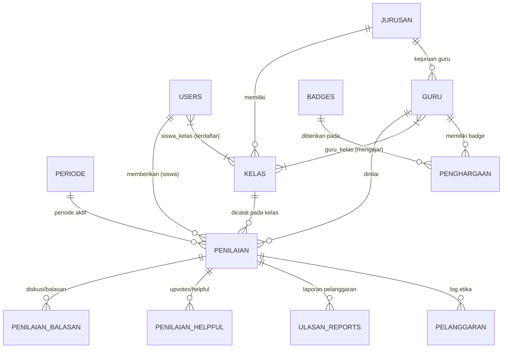

# 📘 Dokumentasi Arsitektur & Spesifikasi Lengkap Sistem GuruKuu

> ### ⚠️ PANDUAN MUTLAK UNTUK AI & DEVELOPER BARU (OPERATING DIRECTIVE)
> Dokumen ini adalah **Source of Truth (Sumber Kebenaran Tunggal)** dari seluruh arsitektur sistem GuruKuu.
> Setiap AI atau pengembang baru yang menangani proyek ini **WAJIB MEMATUHI PROTOKOL BERIKUT**:
>
> 1. **BACA DAHULU SEBELUM MENGUBAH APAPUN:** Jangan pernah mengubah kode, database, atau tampilan UI tanpa membaca bagian terkait di dokumen ini terlebih dahulu agar Anda memahami seluruh rantai ketergantungan sistem.
> 2. **KEWAJIBAN MEMPERBARUI DOKUMEN INI (*LIVING DOCUMENTATION*):** Jika Anda diminta melakukan revisi, menambah fitur baru, mengubah rumus, atau menambah tabel/kolom database, Anda **WAJIB langsung memperbarui file ini** agar AI atau developer berikutnya selalu mendapatkan informasi terkini.
> 3. **KEAMANAN KODE & ZERO SIDE EFFECTS:** 
>    * Dilarang keras merusak relasi dan aturan evaluasi: **Siswa hanya boleh menilai guru yang mengajar di kelasnya (`guru_kelas`)**.
>    * Dilarang merusak tampilan Desktop ketika sedang memperbaiki tampilan Mobile (dan sebaliknya).
>    * Pertahankan warna identitas brand utama: Navy Blue (`#003366`) dan Amber/Orange (`#ff6600`).
> 4. **EFISIENSI & MINIMAL BUG:** Bekerja cepat, tuntas, tanpa penjelasan bertele-tele di respons chat (ikuti [AGENTS.md](file:///c:/Users/ADVAN/PROJEK/Laravel/GuruKuu/AGENTS.md)).

---

## 1. Ringkasan Eksekutif & Tujuan Sistem
**GuruKuu** adalah platform web evaluasi kinerja dan apresiasi guru berbasis sekolah yang memungkinkan siswa memberikan penilaian objektif, umpan balik anonim yang aman, serta penghargaan berbasis reputasi (*leaderboard* & *badges*).

### Nilai Utama Sistem:
1. **Objektivitas & Keadilan:** Siswa hanya dapat menilai guru yang benar-benar mengajar di kelasnya.
2. **Anonimitas yang Terlindungi & Beretika:** Identitas siswa disamarkan (*anonim*), namun setiap kata kasar/toxic secara otomatis dideteksi dan dicatat di audit log pelanggaran admin.
3. **Dukungan Dua Sisi (Guru & Siswa):** Guru dapat menanggapi ulasan siswa secara edukatif dalam thread diskusi tertutup atau publik.
4. **Akurasi Data Sekolah:** Terintegrasi penuh dengan sistem induk sekolah (**SiPintu**) via OAuth SSO dan sinkronisasi data guru, siswa, kelas, serta jadwal.

---

## 2. Arsitektur Teknologi (*Tech Stack*)

| Lapisan | Teknologi / Pustaka | Keterangan |
| :--- | :--- | :--- |
| **Backend Framework** | Laravel 11 / PHP 8.3+ | Arsitektur MVC, Eloquent ORM, Middleware Pipelines, Artisan CLI |
| **Database** | MySQL / MariaDB | Relasi relasional dengan foreign keys, cascading deletes, dan index query |
| **Frontend Rendering** | Blade Templating Engine | Server-Side Rendering (SSR) modular berbasis layout & partials |
| **CSS Framework** | Bootstrap 5.3 + Custom CSS System | Token kustom CSS (`resources/css/app.css`), tanpa ketergantungan utility tailwind |
| **Icons & Typography** | Bootstrap Icons + Inter Font | Tipografi Google Font Inter dengan hierarki keterbacaan tinggi |
| **Interaktivitas Frontend**| Vanilla JS (ES6+) + Alpine.js | Micro-interactions, polling chat/stream, modal handling, live filter |
| **Autentikasi & Sesi** | Laravel Session + Multi-Device Tracking | Audit IP, user agent, revoke device session, remember me |
| **Integrasi Eksternal** | OAuth 2.0 Client & REST API | Terhubung ke SSO dan Webhook/API SiPintu |

---

## 3. Skema Basis Data & Relasi Model Eloquent



### Penjelasan Model-Model Inti:

1. **`User` (`users`)**:
   * Menampung seluruh pengguna: Siswa, Guru, dan Admin.
   * Atribut penting: `nis` (NIS siswa / NIP guru), `nama`, `email`, `role` (`admin`, `guru`, `siswa`), `status_aktif`, `deactivated_until`, `deactivated_reason`.
   * Relasi: `kelas()` (via pivot `siswa_kelas`), `penilaian()`, `loginHistories()`.

2. **`Guru` (`guru`)**:
   * Data master profil pengajar.
   * Atribut: `nip`, `nama`, `kategori` (`normada` / `produktif`), `jurusan_id`, `photo`, `bio`, `rata_rata_nilai`, `total_penilaian`.
   * Relasi: `kelas()` (via pivot `guru_kelas` dengan pivot `mata_pelajaran`), `jurusan()`, `penilaian()`, `penghargaan()`, `badges()`.

3. **`Kelas` (`kelas`) & `Jurusan` (`jurusan`)**:
   * `Kelas`: `nama_kelas`, `tingkat` (10, 11, 12), `jumlah_siswa`, `jurusan_id`.
   * `Jurusan`: `kode_jurusan` (e.g., RPL, TKJ), `nama_jurusan`.

4. **`Penilaian` (`penilaian`)**:
   * Inti dari transaksi evaluasi.
   * 5 Aspek Bintang (skala 1–5): `kedisiplinan`, `komunikasi`, `tanggung_jawab`, `kreativitas`, `keramahan`.
   * Agregasi: `total_nilai` (skor 5–25), `rata_rata_evaluasi` (total / 5).
   * Kualitatif: `kritik`, `saran`.
   * Moderasi: `is_censored`, `censored_reason`.
   * Relasi: `siswa`, `guru`, `periode`, `kelas` (`class_id`), `balasans()`, `helpfuls()`.

5. **`Periode` (`periode`)**:
   * Mengatur putaran semester aktif: `nama_periode`, `tahun_ajaran` (misal 2024/2025), `semester` (ganjil/genap), `status` (`aktif`/`nonaktif`).

6. **`PenilaianBalasan` & `PenilaianHelpful`**:
   * Fitur sosial dua arah: Balasan komentar guru/siswa dan tanda jempol (*helpful like*) ala toko aplikasi.

7. **`Pelanggaran` & `UlasanReport`**:
   * Audit trail otomatis kata toxic, sensor ulasan, dan tiket aduan dari pengguna.

8. **`Kontak` (`kontak`)**:
   * Modul perpesanan/live helpdesk real-time polling antara Siswa/Guru/Guest dengan Admin.

9. **`Setting` (`settings`)**:
   * Penyimpanan konfigurasi dinamis (hero landing page dengan teks & tombol terpadu dan slider gambar latar, status maintenance, label & judul & subtitle statistik, label & judul & subtitle & catatan apresiasi disclaimer leaderboard, threshold kata kasar).
   * Dilengkapi live preview real-time di Admin Pengaturan, navigasi slider vertikal tengah di mobile & desktop, dan sinkronisasi otomatis ke Beranda publik, portal Siswa, portal Guru, dan portal Admin.

---

## 4. Logika Bisnis Utama (*Core Business Logics*)

### A. Validasi & Hak Menilai Siswa
* **Syarat Utama:** Siswa **hanya bisa** menilai guru yang terdaftar mengajar di kelas aktif siswa tersebut pada tahun ajaran yang bersangkutan.
* **Batas Penilaian:** 1 siswa = 1 penilaian untuk 1 guru per periode aktif (berlaku aturan `unique constraint`).
* **Fitur Nilai Ulang / Hapus:** Siswa diberikan hak untuk menghapus penilaian atau mereset dan mengisi ulang penilaian jika diperlukan.

### B. Rumus & Algoritma Leaderboard
Sistem memiliki 2 mode peringkat di `Guru::leaderboardFor()`:

1. **Mode Rating Kepuasan (Semua Guru):**
   * Menghitung rata-rata skor bintang dari seluruh siswa yang menilai guru di periode aktif.
   * **Isolasi Ketat Periode:** Penilaian wajib difilter secara ketat dengan `where('periode_id', $periodeId)` sehingga ulasan arsip periode lampau tidak pernah bocor ke periode berjalan. Jika tidak ada periode aktif/valid, sistem langsung mengembalikan koleksi kosong (`collect()`).
   * **Kelayakan Peringkat:** Seluruh guru yang memiliki penilaian (`total_penilaian > 0`) pada periode aktif diberikan nomor peringkat berurutan (#1, #2, dst.) yang diurutkan berdasarkan `rata_rata_nilai` DESC, `total_penilaian` DESC, dan `nama` ASC.
   * **Batasan Tampilan Publik / Pengguna:** Dibatasi hanya menampilkan **Top 10** (`take(10)`).

2. **Mode Berdasarkan Kelas (Guru Mengajar di Kelas X):**
   * Menghitung rata-rata nilai bintang dari siswa kelas bersangkutan (`class_id`) pada periode aktif yang dipilih.
   * **Hirarki Pengurutan yang Adil:**
     1. **Rating Kepuasan Utama (`rata_rata_nilai` DESC):** Guru dengan skor bintang tertinggi di kelas tersebut berhak menempati peringkat teratas.
     2. **Tie-Breaker 1 (`total_penilaian` DESC):** Jika nilai bintang sama, guru dengan jumlah siswa penilai terbanyak di kelas tersebut menempati peringkat lebih tinggi.
     3. **Tie-Breaker 2 (`partisipasi_persen` DESC):** Persentase partisipasi siswa kelas `(siswa penilai / total siswa kelas) * 100%`.
     4. **Tie-Breaker 3 (`nama` ASC):** Urutan alfabetis nama.
   * **Kelayakan Peringkat:** Seluruh guru pengajar kelas tersebut yang telah menerima evaluasi (`total_penilaian > 0`) otomatis mendapatkan peringkat berurutan (#1 s/d #N) tanpa dieliminasi oleh ambang batas 5 suara, sehingga leaderboard kelas tidak pernah kosong.
   * **Batasan Tampilan Publik / Pengguna:** Dibatasi hanya menampilkan **Top 5** (`take(5)`).

3. **Kebijakan Tampilan & Privasi Leaderboard:**
   * **Penyembunyian Keterangan Minimal:** Keterangan teknis seperti *"minimal 5 ulasan untuk masuk top"* dihilangkan dari antarmuka publik, siswa, dan guru agar tampilan bersih dan elegan.
   * **Akses Penuh Administrator:** Halaman Admin Leaderboard (`/admin/leaderboard`) tetap menampilkan seluruh guru dan seluruh peringkat tanpa pemotongan limit (tidak dibatasi Top 10/Top 5) untuk keperluan audit.
   * **Peringkat Pribadi Guru (*Private Personal Ranking*):** Di Dashboard Guru (`/guru/dashboard`) dan Leaderboard Guru (`/guru/leaderboard`), guru dapat melihat posisi peringkat sekolahnya sendiri secara rahasia (misal *"Peringkat #15 dari 60 Guru"*). Guru di luar Top 10 tidak muncul di leaderboard publik sehingga aman dari ledekan, sekaligus tetap memberi ruang refleksi diri pribadi.
   * **Klaim Anonimitas Penuh Siswa:** Di Dashboard Guru dan Halaman Ulasan Guru (`/guru/ulasan`), detail kelas spesifik (seperti *MPLB 2 Kelas 11*) disamarkan menjadi hanya nama/kode jurusan (seperti *Jurusan MPLB*) agar identitas siswa tidak teridentifikasi.

### C. Keamanan & Filter Konten Cerdas (*Profanity Filter Service*)
* `ProfanityFilterService.php`:
  * Menggunakan kamus kata terlarang dwibahasa (Indonesia & Inggris).
  * Dilengkapi normalisasi teks leetspeak (misal `4nj1ng` $\rightarrow$ `anjing`).
  * Mencegah injection link / external URL luar di kritik dan saran.
  * Jika ulasan terdeteksi kasar saat dikirim: Form input dikosongkan, skor bintang tetap disimpan, insiden dicatat di tabel `pelanggaran`, dan siswa diberikan peringatan mendidik.

### D. Mode Pemeliharaan Siswa (*Maintenance System*)
* Ditangani oleh middleware `CheckSiswaMaintenance.php` dan `MaintenanceService.php`.
* Saat aktif: Siswa tetap bisa membaca dashboard, melihat profil guru, dan ulasan, tetapi form pengiriman nilai dan kirim pesan dikunci (*read-only* dengan modal informasi).

### E. Pelacakan Sesi & Multi-Device Login Audit (`LoginHistory`)
* Setiap browser/perangkat diidentifikasi secara unik menggunakan token kriptografi **`session_id`** Laravel.
* Meskipun beberapa perangkat berada di **jaringan WiFi yang sama (IP sama)** atau browser yang identik, setiap perangkat dicatat sebagai baris sesi terpisah.
* Terintegrasi penuh baik pada form login manual (`LoginController`) maupun autentikasi SSO SiPintu (`OAuthController`).
* Fitur *revoke* / "Keluarkan Perangkat Lain" dan "Keluarkan Semua Perangkat" menghapus sesi dari tabel `sessions` dan menandai riwayat sebagai `logged_out` secara instan.

### F. Autentikasi Terpusat & Sinkronisasi Kata Sandi SiPintu (*Single Source of Truth*)
* **Otoritas Kredensial:** Server induk **SiPintu Gateway** (`/api/v1/auth/verify-credentials`) berfungsi sebagai otoritas kebenaran tunggal (*Single Source of Truth*) untuk kata sandi Siswa dan Guru.
* **Penolakan Kata Sandi Lama:** Form login (`LoginController`) memvalidasi kredensial langsung ke SiPintu terlebih dahulu. Jika pengguna telah mengganti kata sandi di SiPintu, SiPintu akan menolak kredensial lama (`invalid_credentials`), dan GuruKuu secara otomatis menolak akses login sehingga kata sandi lama **tidak dapat digunakan lagi**.
* **Sinkronisasi Otomatis Hash Baru:** Saat pengguna login dengan kata sandi baru, SiPintu mengonfirmasi kevalidan dan GuruKuu secara otomatis menyelaraskan hash kata sandi lokal di database (`users.password`) serta mencatat `sipintu_last_synced_at`.
* **Dukungan Webhook & SSO Callback:** Webhook `/api/sipintu/sync-user` dan alur OAuth `/oauth/callback` otomatis memperbarui hash kata sandi lokal jika dikirimkan oleh SiPintu Gateway.
* **Redundansi Darurat (*Disaster Recovery*):** Hanya jika gateway SiPintu offline / gagal koneksi, GuruKuu menggunakan hash lokal terakhir sebagai cadangan darurat agar operasional sekolah tetap berjalan. Akun lokal khusus (admin / testing) tetap didukung mulus.
* **Penanganan Fleksibel NIP 0 / Guru Tanpa NIP & Login via Email:**
  * Guru yang memiliki NIP `0` atau belum memiliki NIP resmi (contoh: guru honorer/baru dari SiPintu) dapat login menggunakan alamat **Email** terdaftar maupun NIP.
  * Form login guru mendukung input ganda: NIP atau Email (`where('nip', $nis)->orWhere('email', $nis)`).
  * Admin dapat mengubah/menyetel NIP sementara guru di menu **Edit Profil Guru** (`/admin/guru/{id}/edit`). Saat NIP diubah, sistem otomatis memperbarui `users.nis` agar selaras dengan `guru.nip` tanpa merusak riwayat ulasan siswa maupun pembagian kelas mengajar.
  * Tersedia fitur **Reset Password Guru** langsung di menu aksi dropdown tabel Admin (`/admin/guru`) serta opsi ubah password di halaman Edit Guru, dengan fallback verifikasi hash lokal jika kredensial diset manual oleh admin.
  * Logika sinkronisasi SiPintu (`syncTeacherToLocal`) dirancang cerdas: jika guru lokal telah memiliki NIP kustom/valid yang diset admin, penarikan data berkala dari SiPintu yang membawa NIP `'0'` **tidak akan menimpa** NIP lokal kembali ke `'0'` dan tidak menimbulkan duplikasi guru.

### G. Panduan Interaktif Pemula (*Callout Guide Tooltip*)
* **Penunjuk Otomatis Menu "Daftar Guru":** Tooltip pill interaktif ("👉 Ketuk di sini untuk menilai") menunjuk menu navigasi evaluasi guru pada dashboard siswa.
* **Pelacakan Posisi Dinamis (*Dynamic Geometry Anchoring*):** Menggunakan `ResizeObserver`, listener scroll container sidebar, dan sinkronisasi `requestAnimationFrame` untuk memastikan posisi tooltip selalu presisi dan sejajar tegak lurus (`centerY`) di sebelah item "Daftar Guru", bahkan ketika ukuran sidebar membesar/mengecil atau terjadi pergeseran layout.
* **Sinkronisasi Titik Biru & Popover (*Coupled Indicator*):** Titik biru berdenyut (`gk-menu-highlight`) pada item "Daftar Guru" dikendalikan terpadu secara dinamis bersama popover panduan. Titik biru hanya aktif jika panduan aktif; saat tombol silang `(X)` diklik atau saat siswa berpindah tab/halaman lalu kembali, titik biru tidak akan muncul jika panduan sedang dalam status ditutup.
* **Siklus Hidup Status (*Session-Based Dismissal*):** Ketika tombol silang `(X)` diklik, status disimpan di `sessionStorage` agar tidak muncul lagi selama siswa sedang bernavigasi di website. Saat siswa keluar web (tutup tab/browser) atau keluar akun (logout) lalu login ulang, flag otomatis di-reset sehingga panduan dan titik penunjuk muncul kembali. Flag permanen `localStorage` telah dibersihkan.

### H. Histori Penilaian, Moderasi Kritik & Saran, dan Concurrency Voting
* **Inklusi Seluruh Evaluasi & Vote Secara Default (`Admin\KritikSaranController`):**
  * Halaman moderasi Kritik & Saran (`/admin/kritik-saran`) secara default menampilkan **seluruh penilaian/vote** (termasuk yang hanya memberikan skor rating bintang tanpa teks kritik/saran). Hal ini mencegah hilangnya data evaluasi dari pantauan admin ketika siswa hanya mengisi penilaian bintang 1–5.
  * Opsi filter cakupan ulasan:
    * `Semua Penilaian / Vote` (default): Menampilkan seluruh rekaman penilaian siswa.
    * `Hanya Ada Kritik/Saran`: Memfilter penilaian yang memiliki teks pesan kritik/saran tertulis.
    * `Hanya Rating Bintang`: Memfilter evaluasi yang murni berisi rating bintang tanpa teks masukan.
* **Filter Berdasarkan Kelas (`kelas_id`):**
  * Dilengkapi filter dropdown kelas pada toolbar pencarian admin (`/admin/kritik-saran`), mempermudah pemantauan feedback dan partisipasi per kelas tertentu.
  * Menggunakan pencarian gabungan relasi langsung `class_id` maupun relasi `siswa.kelas` untuk memastikan keakuratan data.
* **Proteksi Konkurensi & Anti-Double Submit (`Siswa\PenilaianController`):**
  * **Transaksi Database Atomik & Retry:** Proses penyimpanan penilaian dan pembaruan rata-rata nilai guru dibungkus dalam `DB::transaction(..., 3)` dengan `lockForUpdate()` untuk mencegah kondisi balapan (*race condition*) saat puluhan siswa mengirimkan vote secara bersamaan.
  * **Penanganan Duplikasi Anggun (*Graceful Duplicate Handling*):** Jika terjadi balapan jaringan atau klik ganda yang memicu `UniqueConstraintViolationException` / error SQLSTATE 23000, sistem secara anggun mengarahkan siswa ke halaman profil guru dengan notifikasi informasi bahwa penilaian telah tersimpan, tanpa melemparkan error 500.
  * **Resolusi Kelas Fleksibel (*Fallback Mapping*):** Mengidentifikasi kelas aktif siswa dengan fallback berjenjang (`wherePivot` $\rightarrow$ relasi `kelas` $\rightarrow$ nama kelas string) sehingga kolom `class_id` pada tabel `penilaian` selalu terisi dengan benar.
  * **Anti-Double Click Frontend:** Tombol pengiriman penilaian pada form siswa otomatis dimatikan (*disabled*) dan menampilkan indikator loading saat proses submit berjalan.

### I. Anonimitas Siswa & Penyamaran Identitas Kelas di Portal Guru
* **Prinsip Anonimitas Mutlak bagi Guru & Publik:** Guru yang dinilai tidak boleh mengetahui identitas siswa penilai (nama, NIS, maupun rombel/kelas detail siswa).
* **Penyamaran Kelas Menjadi Jurusan Saja:**
  * Pada riwayat ulasan guru (`/guru/ulasan`) dan feed dashboard guru (`/guru/dashboard`), rincian kelas siswa (misalnya `MPLB 2 Kelas 11` atau `PPLG 1 Kelas 12`) **wajib disamarkan** dan hanya menampilkan **Jurusan** saja (misalnya `Jurusan MPLB` atau `Jurusan PPLG`).
  * Hal ini menjamin guru tidak dapat melacak atau menyimpulkan siswa penilai dari kelas atau tingkat tertentu, menjaga kenyamanan dan objektivitas siswa saat memberikan evaluasi.
  * Hanya Administrator sekolah (`/admin/kritik-saran`) yang memiliki hak akses melihat rincian kelas dan NIS/nama siswa demi keperluan pengawasan etika dan akuntabilitas.

---

## 5. Peta Hak Akses & Peran Pengguna (*Roles & Permissions*)

| Peran (*Role*) | Akses Menu & Fungsionalitas Utama |
| :--- | :--- |
| **Siswa** | • Dashboard (statistik ulasan saya, notifikasi pelanggaran/peringatan, podium top guru).<br>• Daftar Guru (Filter *Guru Kelas Saya* vs *Semua Guru*, indikator status *Sudah/Belum Dinilai*).<br>• Detail Guru (Statistik bintang per aspek, ulasan siswa, diskusi balasan).<br>• Form Penilaian (5 bintang, quick chip kritik/saran santun).<br>• Riwayat Penilaian (opsi hapus & nilai kembali).<br>• Leaderboard & Pengaturan Akun / Kontak Admin. |
| **Guru** | • Dashboard Guru (skor kepuasan pribadi, total penilai, radar aspek evaluasi).<br>• Kotak Ulasan Masuk (membaca feedback siswa anonim & membalas tanggapan).<br>• Leaderboard Sekolah & Detail Profil Guru Lain.<br>• Pengaturan Profil & Kontak Bantuan Admin. |
| **Admin** | • Dashboard Analitik (total penilaian, statistik distribusi bintang, cache management).<br>• Master Data: Guru, Siswa, Jurusan, Kelas, Badge, Periode Semester.<br>• Integrasi SiPintu: Import / Sync massal API data guru, siswa, kelas, jadwal.<br>• Moderasi: Sensor ulasan, audit pelanggaran etika, tindakan suspensi akun.<br>• Live Helpdesk Chat: Balas pesan Siswa, Guru, dan Tamu.<br>• Ekspor Laporan: PDF & Excel (Leaderboard, Data Guru, Data Siswa, Zip All).<br>• Pengaturan Global: Maintenance mode toggle, kata toxic, hero banner. |
| **Guest (Publik)**| • Landing Page Profil Sekolah, Preview Leaderboard Publik, Detail Guru Publik, Kontak Bantuan Tamu. |

---

## 6. Standar Desain UI/UX (*Design System*)

* **Color Palette (`resources/css/app.css`):**
  * `Primary`: `#003366` (Navy Blue — kesan institusional, profesional, stabil).
  * `Primary Light`: `#004d99` & `Primary Subtle`: `#e0edff`.
  * `Secondary / Accent`: `#ff6600` / `#f97316` (Warm Orange — energi, bintang penghargaan, badge).
  * `Background Light`: `#f8fafc` & `Card Surface`: `#ffffff`.
  * `Text Dark`: `#0f172a` & `Text Muted`: `#64748b`.
  * `Borders`: `#e2e8f0`.

* **Prinsip Tata Letak & Responsivitas:**
  * **Desktop:** Sidebar navigasi vertikal kokoh + topbar status profil dan notifikasi.
  * **Mobile:** Bottom navigation bar mengambang yang ergonomis untuk navigasi jempol, kartu responsif 1 kolom.
  * **Zero Glitch Aspect-Ratio:** Tombol aksi bulat dan foto profil guru diberi pengunci `aspect-ratio: 1 / 1 !important` untuk mencegah distorsi oval saat teks panjang.
  * **Micro-Animations:** Transisi halus pada kartu guru (`translateY(-5px)` on hover), progress bar warna bertahap (*gk-bar-blue-high*, *gk-bar-blue-mid*, *gk-bar-blue-low*).

---

## 7. Direktori & Berkas Penting (*Codebase Map*)

```
GuruKuu/
├── app/
│   ├── Http/
│   │   ├── Controllers/
│   │   │   ├── Admin/         # Controller dashboard, guru, siswa, periode, pelanggaran, sipintu, export
│   │   │   ├── Guru/          # Controller dashboard guru, balasan ulasan, profil
│   │   │   ├── Siswa/         # Controller dashboard siswa, penilaian, guru, leaderboard
│   │   │   ├── Auth/          # LoginController, OAuthController (SiPintu), DeviceSessionController
│   │   │   └── LandingController.php
│   │   └── Middleware/        # CheckRole, CheckSiswaMaintenance, CheckActivePeriode
│   ├── Models/                # User, Guru, Kelas, Jurusan, Penilaian, Periode, Pelanggaran, dll.
│   └── Services/
│       ├── ProfanityFilterService.php   # Sensor kata kasar & anti-toxic bilingual
│       ├── SiPintuService.php           # Komunikasi API & Sync sinkronisasi data sekolah
│       ├── MaintenanceService.php        # Logika sakelar pemeliharaan sistem
│       └── GuruJadwalImportService.php  # Parser excel/csv jadwal mengajar
├── resources/
│   ├── css/app.css            # Token desain, variabel warna, utilitas kartu
│   └── views/
│       ├── layouts/           # admin.blade.php, siswa.blade.php, guru.blade.php, landing.blade.php
│       ├── siswa/             # View modul siswa (guru grid, guru show, penilaian create, leaderboard)
│       ├── guru/              # View modul guru (dashboard, ulasan masuk)
│       ├── admin/             # View modul admin (guru, siswa, jurusan, sipintu, pelanggaran, dll.)
│       └── components/        # Modal report, thread balasan ulasan, laurel badge podium
└── routes/
    └── web.php                # Seluruh deklarasi endpoint rute aplikasi
```

---

## 8. Log Riwayat Perubahan Dokumentasi (Changelog)
*Setiap kali ada revisi, AI / Developer wajib mencatat entri singkat di sini.*

* **2026-10-16:** Inisialisasi dokumentasi lengkap sistem, validasi relasi database per kelas, rumus leaderboard, dan penambahan protokol wajib untuk AI berikutnya.
* **2026-10-16 (Optimasi Hosting):** Penerapan kompresi GZIP dan Expire Headers di `.htaccess`, implementasi persistent caching 60 detik pada `Guru::leaderboardFor()` dengan auto-invalidation, serta penambahan `loading="lazy"` pada gambar/avatar kartu guru.
* **2026-10-17 (Reverse Proxy & Pengaturan Admin Sync):** 
  - Penambahan `$middleware->trustProxies(at: '*')` di `bootstrap/app.php` dan `URL::forceScheme('https')` di `AppServiceProvider.php` agar form POST di lingkungan server reverse proxy/Cloudflare tidak ter-redirect 301 ke GET.
  - Penambahan input `leaderboard_catatan` di Admin Pengaturan dengan real-time live preview serta rendering dinamis pada 5 view leaderboard (Landing, Public Leaderboard, Siswa, Guru, Admin).
  - Penyatuan teks dan CTA tombol hero slider agar seragam di semua slide, hanya thumbnail background yang berganti, serta perataan vertikal tombol panah slide hero pada tampilan mobile.
  - Implementasi metode `Setting::clearCache()` untuk memastikan pembersihan in-memory cache dan cache key `gurukuu_all_settings` saat pengaturan diperbarui.
  - Menghapus serialisasi Eloquent Model/Collection di `Cache::put` pada `Guru::leaderboardFor()` yang memicu error fatal `__PHP_Incomplete_Class` saat `unserialize()` dipanggil oleh driver cache di PHP 8.3+. Runtime cache kini menggunakan `self::$leaderboardCache` (in-memory, aman 100%).
  - Menghilangkan `Cache::remember('gurukuu_all_settings')` dari `Setting::allCached()` dan beralih ke pembacaan langsung database dengan in-memory cache runtime per request (`$runtimeCache`), menjamin perubahan di Admin Pengaturan langsung aktif seketika tanpa tertahan cache stale database.
  - Penyesuaian panah hero slider mobile ke posisi `top: 38%` (sejajar teks judul) dengan ukuran proporsional 32px, serta penambahan indikator kapsul emas (`bottom: 14px`) yang selalu tampak di tampilan mobile.
* **2026-10-17 (Hero Slider Mobile Navigation & Setting Emptying Refinements):**
  - Mengizinkan pengosongan nilai (empty string `""`) pada pengaturan admin di `Setting::get()` tanpa memaksakan kembali fallback default teks bawaan.
  - Menghapus border/garis tepi stroke pada tombol panah navigasi slider hero, menggantinya dengan latar belakang frosted glass putih lembut (`rgba(255, 255, 255, 0.22)`) yang kontras jelas tanpa menutupi teks (`padding-left: 56px` & `padding-right: 56px`).
  - Menerapkan navigasi panah terikat (bounded navigation) menggunakan `getSlideIndex()` berbasis elemen slide aktual pada event `slide.bs.carousel` dan `slid.bs.carousel`: Halaman pertama hanya menampilkan panah kanan, halaman terakhir hanya menampilkan panah kiri, dan halaman tengah menampilkan kedua panah (`data-bs-wrap="false"`).
  - Mengubah warna indikator garis aktif menjadi putih murni (`#ffffff`) tanpa efek glow/bayangan bercahaya, menghapus total latar belakang kapsul hitam/gelap pada indikator (baik desktop maupun mobile) menjadi garis putih flat melayang bersih, memindahkan tombol panah mobile ke bawah pojok kiri dan kanan (`bottom: 12px`), serta mengompres tinggi hero mobile (`min-height: 350px`) agar proporsional tanpa menutupi konten.
* **2026-10-17 (Fitur Edit & Hapus Diskusi Ulasan & Pembersihan Teks):**
  - Menghapus seluruh tulisan atau penyebutan nama aplikasi luar seperti "(Mirip Discord)" pada tampilan UI maupun backend komentar dan notifikasi.
  - Menambahkan rute dan controller `PUT /penilaian-balasan/{balasan}` (`PenilaianBalasanController@update`) dengan proteksi keamanan (cek kepemilikan author, sensor kata kasar / anti-toxic bilingual, pencegahan link luar, dan sinkronisasi real-time ulasan).
  - Mengimplementasikan fitur **Edit Pesan Diskusi** inline secara instan via AJAX dan **Hapus Pesan Diskusi** dengan konfirmasi SweetAlert untuk siswa dan guru pada ulasan mereka sendiri.
  - Memperbaiki pengecekan ID author `(int)$currentUser->id === (int)$b->user_id` agar tombol kontrol edit & hapus selalu tampil akurat tanpa masalah perbedaan tipe data PHP.
* **2026-10-29 (Leaderboard Capping, Tampilan Peringkat Privat Guru, & Anonimitas Kelas):**
  - Mengubah tampilan leaderboard pengguna/publik (Landing, Siswa, Guru): Mode rating Semua Guru dibatasi **Top 10**, dan mode Berdasarkan Kelas dibatasi **Top 5**.
  - Menghapus teks teknis "minimal 5 ulasan untuk masuk top" pada semua tampilan leaderboard publik dan pengguna.
  - Menjaga akses **Admin Leaderboard** tetap lengkap tanpa pemotongan limit sehingga admin dapat memantau seluruh peringkat.
  - Menambahkan kartu **Peringkat Pribadi** di Dashboard Guru (`/guru/dashboard`) dan banner status pribadi di Leaderboard Guru (`/guru/leaderboard`), memungkinkan guru mengetahui posisi peringkatnya sendiri secara rahasia untuk sarana evaluasi diri tanpa khawatir dirundung jika di luar Top 10.
  - Menyamarkan identitas kelas menjadi kode/nama jurusan (misal `Jurusan PPLG`) pada ulasan di Dashboard Guru dan Halaman Ulasan Guru untuk menjaga anonimitas siswa 100%.
* **2026-10-29 (Penanganan NIP 0, Login Guru via Email, & Sinkronisasi Akun Lokal):**
  - Memperbaiki alur login guru (`LoginController`) agar dapat mendeteksi kredensial via NIP maupun Email (`emarosma20@gmail.com`).
  - Menyelaraskan form login guru dengan label dan placeholder "NIP / EMAIL GURU".
  - Memperbaiki sinkronisasi akun guru pada menu Edit Guru (`Admin\GuruController@update`): saat admin mengubah NIP sementara dari `0` ke NIP baru, `users.nis` otomatis ikut terupdate dan sinkron.
  - Menambahkan fitur **Reset Password Guru** langsung di menu aksi dropdown tabel admin (`/admin/guru`) serta opsi ganti password di form Edit Guru.
  - Mengamankan proses sinkronisasi SiPintu (`syncTeacherToLocal`): NIP guru yang telah diset kustom/valid oleh admin tidak akan ditimpa kembali menjadi `0` saat ada sinkronisasi berkala dari SiPintu Gateway.
* **2026-10-29 (Pengarsipan Periode, Filter Ulasan Dinamis, Persistensi Tab, & Pembersihan Bug UI/UX):**
  - **Pengarsipan Ulasan Periode Lalu & Dashboard Guru:** Ulasan pada `Guru\DashboardController::index` difilter sesuai periode aktif (`where('periode_id', $periodeAktif->id)`) sehingga ulasan semester sebelumnya otomatis masuk arsip dan tidak menumpuk di dashboard aktif guru.
  - **Penghapusan Penilaian & Leaderboard Cache:** Menambahkan model event `booted()` pada `Penilaian` (`deleted` dan `saved`) yang otomatis memicu `Guru::clearLeaderboardCache()` dan `guru->updateRataRata($penilaian->periode_id)` saat ulasan dihapus atau diubah.
  - **Nama Periode Unik:** Menambahkan validasi `Rule::unique('periode', 'nama_periode')` pada `PengaturanController` dan `PeriodeController` untuk mencegah duplikasi nama periode yang membingungkan.
  - **Histori Periode Admin Leaderboard:** Admin kini dapat memilih periode riwayat/arsip pada Leaderboard (`/admin/leaderboard`) serta mengekspor Excel/PDF sesuai periode yang dipilih.
  - **Header & Catatan Leaderboard Rapi:** Judul, subjudul, dan kotak catatan pada Admin Leaderboard telah dipusatkan (*text-center*) secara simetris.
  - **Persistensi Tab Login (Guru vs Siswa):** Saat login gagal (password salah), tab peran yang dipilih tetap dipertahankan (`old('login_role')`), dan alert error disejajarkan simetris (`align-items-center gap-2`).
  - **Persistensi Tab Pengaturan (Admin, Guru, Siswa):** Tab aktif disimpan via URL hash, `active_tab` session, dan `localStorage` agar tidak melompat ke tab pertama saat refresh atau submit.
  - **Kartu Statistik Ulasan Guru Dinamis:** Di `/guru/ulasan`, kartu metrik Total Ulasan, Sudah Dibalas, dan Belum Dibalas kini tersinkronisasi dinamis mengikuti filter periode semester dan filter teks yang dipilih guru.
  - **Sinkronisasi Titik Biru Panduan Siswa:** Titik biru dan popover panduan kini hanya di-reset pada login baru (`fresh_login_for_guide`) dan dipastikan tetap hilang di semua tab sidebar saat sudah ditutup pengguna.
* **2026-10-29 (Penyempurnaan Total Sistem Pencarian Global & Penghapusan Auto-Suggest Siswa):**
  - **Penghapusan Auto-Suggest Siswa:** Menghapus autocomplete dropdown pop-up (`#guruSearchSuggestions`) pada portal siswa (`/siswa/guru`) agar siswa dapat mengetik nama guru sendiri dengan leluasa dan mencari secara alami via Enter atau tombol Cari.
  - **Pencarian Multi-Kata & Tokenisasi Fleksibel:** Mengganti pencarian string kaku menjadi pencarian token kata terpisah (`preg_split('/\s+/')`) pada seluruh modul web (Portal Siswa, Data Guru Admin, Data Siswa Admin, Kritik & Saran, Pelanggaran, Manajemen Akun, SiPintu Gateway, dan Pencarian Publik). Mencari kata penggalan seperti *"latif"* atau susunan kata terbalik seperti *"latif abdul"* kini 100% akurat menemukan *"M. Abdul Latif, S.Pd."*.
  - **Resolusi Konflik Filter Kelas vs Pencarian:** Jika pengguna mencari nama guru atau siswa saat filter kelas sedang aktif, sistem secara cerdas mengecek apakah hasil pencarian ada di kelas tersebut; jika guru/siswa yang dicari mengajar/berada di kelas lain, sistem tidak lagi memblokir atau menghasilkan halaman kosong, melainkan tetap menampilkan guru/siswa yang dicari.
* **2026-10-29 (Tampilan Rincian 5 Kriteria Penilaian, Bintang, & Persentase di Portal Guru):**
  - **Halaman Ulasan Guru (`/guru/ulasan`):** Menambahkan kartu ringkasan kriteria evaluasi di atas 3 kartu metrik ulasan. Menampilkan skor keseluruhan (bintang dan persentase) serta rincian 5 kriteria pembelajaran (Ketepatan Waktu, Kehadiran di Kelas, Penyampaian Materi, Interaksi dengan Siswa, Suasana Belajar) lengkap dengan rating bintang (⭐), persentase kepuasan, dan progress bar yang tersinkronisasi dinamis dengan filter semester.
  - **Detail Guru (`/guru/detail-guru/{id}`):** Memperbarui kartu statistik evaluasi periode berjalan agar menampilkan skor keseluruhan di bagian atas dan menyandingkan rating bintang (⭐) bersama persentase (%) pada masing-masing dari 5 kriteria.
  - **Dashboard Guru (`/guru/dashboard`):** Menambahkan kartu "Detail Kriteria Evaluasi" pada kolom utama dashboard yang menampilkan capaian 5 kriteria pengajaran guru (bintang dan persentase) pada semester berjalan secara transparan dan detail.
* **2026-10-29 (Isolasi Ketat Periode Leaderboard, Pemeringkatan Kelas Adil, Reversi Label Login NIP Guru, & Reposisi Tombol Laporkan):**
  - **Isolasi Ketat Periode Leaderboard:** Pada `Guru::leaderboardFor()`, penilaian kini secara ketat wajib difilter dengan `where('periode_id', $periodeId)` dan langsung mengembalikan koleksi kosong jika tidak ada periode aktif/valid. Memastikan ulasan lampau tidak akan pernah mencemari atau masuk ke perhitungan leaderboard periode berjalan.
  - **Pemeringkatan Leaderboard Berdasarkan Kelas & Resolusi Otomatis Kelas Siswa:** Seluruh guru pengajar yang telah menerima penilaian dari kelas tersebut (`total_penilaian > 0`) langsung mendapatkan ranking berurutan (#1, #2, dst.) tanpa digugurkan oleh ambang batas 5 suara. Ditambahkan method `resolveKelasSiswa()` pada `PenilaianController` yang secara cerdas mendeteksi kelas siswa (relasi pivot, kolom string teks kelas, dan auto-sinkronisasi pivot) sehingga kolom `penilaian.class_id` tersimpan 100% akurat dan tidak ada suara siswa baru yang hilang di filter kelas. Query leaderboard kelas kini juga menyertakan deteksi ganda via `penilaian.class_id` maupun relasi kelas siswa pemilih.
  - **Desain Mewah Arsip Riwayat Periode Lalu:** Tampilan ulasan arsip periode lalu di portal guru (`resources/views/guru/show.blade.php`) dan siswa (`resources/views/siswa/guru/show.blade.php`) diperbarui menjadi kartu ulasan lengkap berskala penuh dengan rincian 5 aspek penilaian (bintang ⭐ dan nilai /5), persentase total, progress bar, kotak kritik/saran tematik, serta tombol laporkan di pojok kanan bawah.
  - **Reversi Form Login Guru:** Mengembalikan teks label dan placeholder input guru di `resources/views/auth/login.blade.php` menjadi **NIP GURU** dan *"Masukkan NIP guru"*.
  - **Reposisi Tombol Laporkan Ulasan:** Pada halaman profil guru (`resources/views/guru/show.blade.php`), tombol "Laporkan" dipindahkan dari header samping waktu/anonim ke pojok kanan bawah kartu ulasan, sejajar rapi dengan desain standar ulasan siswa.
* **2026-10-29 (Pemisahan Log Laporan Pengguna vs Pelanggaran Terbukti, Detail Pelapor/Terlapor, & Verifikasi Moderasi Admin):**
  - Mengubah label Tab 1 dari "Semua Log Pelanggaran" menjadi **"Semua Log"**.
  - Memisahkan secara tegas ulasan yang baru dilaporkan pengguna (`tipe: 'laporan_pengguna'` / status `menunggu_verifikasi_admin`) dari pelanggaran sistem yang sudah terbukti. Laporan yang belum diverifikasi tidak lagi dianggap sebagai pelanggaran terbukti dan dikecualikan dari akumulasi "Peringkat Siswa Melanggar" maupun "Peringkat Guru Melanggar".
  - Memperkaya tabel "Semua Log" dengan informasi detail kedua belah pihak: Siswa/penulis yang dilaporkan (*Terlapor*) dan identitas pelapor (*Pelapor*: Nama, peran/role, NIS/NIP/IP, alasan pelaporan, serta catatan keluhan tambahan).
  - Memperbarui badge tipe menjadi **"Laporan Pengguna (Belum Terverifikasi)"** dengan warna peringatan (*warning*) oranye-kuning, bukan badge merah/hitam pelanggaran terbukti.
  - Memperbarui popup modal "Lihat Ulasan" dengan banner peringatan telaah objektif, informasi rincian pelapor, teks lengkap ulasan, serta tombol moderasi instan: **Setujui Laporan & Sensor** atau **Tolak Laporan (Ulasan Bersih)**.
  - **Penyelarasan Tampilan & Menu Titik Tiga (Meatballs Dropdown):** Mengganti deretan tombol aksi individual pada kolom AKSI tabel "Semua Log" menjadi tombol dropdown titik tiga (`...`) yang seragam dan rapi (berisi aksi: Sensor Ulasan, Sanksi Akun, Hapus Ulasan, Tolak Laporan, Tandai Sudah Ditinjau, Hapus Log). Mempercantik baris identitas Terlapor & Pelapor agar proporsional dan sejajar rapi dengan standar tabel modul admin lainnya.
  - **Pembaruan Label Sidebar:** Memperbarui label item navigasi sidebar Admin dari "Log Pelanggaran" menjadi **"Log Pelanggaran Dll"** (`resources/views/layouts/admin.blade.php`).
  - **Sinkronisasi Statistik Kritik & Saran dengan Filter Periode & Kelas:** Memperbarui `Admin\KritikSaranController::index()` agar 4 kartu statistik di bagian atas (Ulasan Teks Masuk, Total Evaluasi, Rata-rata Rating Bintang, Bintang 5 Sempurna, dan Ulasan Disensor) tersinkronisasi dinamis mengikuti filter `periode_id`, `kelas_id`, dan `search`. Menghilangkan bug di mana kartu metrik tetap menampilkan angka total seluruh periode (377 ulasan / 1075 evaluasi) saat admin memilih periode yang belum memiliki ulasan.
  - **Pembaruan Label Tombol Detail Guru:** Mengubah label tombol di halaman detail profil guru (`resources/views/admin/guru/show.blade.php`) dari "Edit Data & Foto Guru" menjadi **"Ubah Data Guru"**.
* **2026-10-29 (Resilient Fallback Gateway SiPintu & Perlindungan Data Lokal):**
  - **Deteksi Upstream 404 SiPintu:** Mengidentifikasi bahwa galat `404` pada menu Gateway SiPintu (`/admin/sipintu/guru?refresh=1`) berasal dari server hulu SiPintu (`sipintu.smkn1bangsri.sch.id`) yang rute `/api/v1/sijuna/teachers`-nya mengembalikan respon *Not Found* ("The route api/v1/sijuna/teachers could not be found"), sementara endpoint ping dan siswa tetap online.
  - **Sistem Cadangan & Fallback Otomatis (`SiPintuService`):** Mengimplementasikan mekanisme *Persistent Backup Cache* (`sipintu_teachers_raw_backup` dan `sipintu_students_raw_backup`) serta rekonstruksi dinamis otomatis dari basis data lokal (`\App\Models\Guru` dan `\App\Models\User` peran siswa). Jika server SiPintu mati, timeout, atau endpoint-nya 404, GuruKuu secara otomatis beralih (*graceful fallback*) ke data lokal tanpa membiarkan tabel kosong menjadi 0 guru/siswa atau menyebabkan sistem macet.
  - **Indikator Mode Cadangan Lokal pada Tampilan Admin:** Memperbarui antarmuka admin SiPintu (`resources/views/admin/sipintu/teachers.blade.php` dan `students.blade.php`) dengan banner informasi mode cadangan lokal aktif (`is_fallback`), sehingga admin mengetahui kondisi server SiPintu hulu dengan jelas sembari tetap dapat meninjau dan mengelola data guru/siswa tanpa hambatan.
  - **Pengamanan Sinkronisasi Batch:** Melindungi controller `Admin\SiPintuController@syncAllTeachers` dan `syncAllStudents` dari proses penimpaan data yang tidak diinginkan saat server hulu sedang dalam mode cadangan / 404.
* **2026-10-29 (Penyederhanaan UI Tab Laporan Pengguna di Log Pelanggaran):**
  - **Penghapusan Avatar Inisial Kotak:** Menghilangkan kotak avatar inisial huruf dengan garis tepi (`avatar-circle-sm`) di samping nama siswa/penulis ulasan pada tab "Laporan dari User" agar tampilan nama rapi, bersih, dan tidak terkesan aneh/dobel inisial.
  - **Pembersihan Teks Subtitle Anti-Spam:** Menghapus teks subtitle panjang *"Sistem anti-spam aktif: Setiap pengguna hanya dapat mengirim 1 kali laporan per ulasan..."* dan sub-label baris tabel agar header kartu serta daftar ulasan yang dilaporkan tampil ringkas, proporsional, dan nyaman dibaca.
* **2026-10-29 (Hover Interaktif Pemilihan Pengguna di Pesan Masuk Admin):**
  - **Efek Seleksi & Visual Feedback Hover (`.kontak-user-item`):** Menambahkan efek visual interaktif (*interactive hover state*) pada daftar pesan masuk admin (`/admin/kontak`). Saat kursor diarahkan ke nama/kartu pengirim, kartu otomatis bertransformasi dengan latar belakang biru lembut (`#f0f7ff`), bingkai tepi halus (`#bfdbfe`), elevasi bayangan halus, perbesaran avatar inisial, dan teks nama berubah menjadi warna aksen utama.
  - **Indikator Aksi "Buka Chat":** Menampilkan petunjuk interaktif dengan transisi meluncur halus (*"Buka Chat →"*) di sisi kanan baris pengguna saat di-hover, mempertegas kepada administrator bahwa baris tersebut dapat langsung diklik untuk membuka ruang percakapan.
* **2026-10-29 (Sinkronisasi Otomatis Periode Aktif vs Arsip & Perpindahan Ulasan):**
  - **Integritas Periode Tunggal Terjamin (`Periode::booted`):** Menerapkan model event `saved` pada `Periode` di mana jika ada satu periode diset atau disimpan berstatus `'aktif'`, seluruh periode lain di database secara otomatis dipaksa menjadi `'nonaktif'` (arsip). Dilengkapi metode `getActivePeriode()` mandiri (*self-healing*) yang menjamin selalu ada tepat 1 periode aktif.
  - **Pemisahan Tegas Ulasan Aktif vs Ulasan Arsip:** Memperbarui seluruh controller detail guru (`Guru\DashboardController@detailGuru`, `Siswa\GuruController@show`, `Admin\GuruController@show`, `LandingController@guruDetail`) sehingga:
    * **Halaman Ulasan Utama / Berjalan:** Hanya menampilkan ulasan yang `periode_id`-nya sama dengan periode aktif berjalan.
    * **Arsip Periode Lalu:** Mengelompokkan seluruh periode berstatus `'nonaktif'` yang memiliki ulasan.
    * **Pertukaran Sempurna (*Clean Swap*):** Saat admin mengaktifkan periode lampau/arsip, seluruh ulasan periode tersebut seketika berpindah ke halaman ulasan utama, sementara periode yang sebelumnya aktif seketika berpindah menjadi kartu arsip periode lalu tanpa ada ulasan yang bocor atau ganda.
  - **Filter Default Ulasan Guru (`/guru/ulasan`):** Halaman riwayat ulasan guru kini secara default langsung memilih periode aktif berjalan (`(Aktif)`), dan guru dapat dengan mudah melihat arsip ulasan lampau atau semua periode melalui dropdown filter.
* **2026-10-29 (Penghapusan Badge 'Tersemat di Atas' pada Ulasan Siswa):**
  - **Pembersihan Badge:** Menghapus label/badge bertuliskan *"Tersemat di Atas"* dan ikon pin pada kartu ulasan siswa di portal siswa (`resources/views/siswa/guru/show.blade.php`).
  - **Preservasi Posisi Prioritas:** Posisi ulasan siswa yang login tetap otomatis diposisikan paling atas secara alami di sisi database/controller (`orderByRaw CASE WHEN siswa_id = ? THEN 0 ELSE 1 END`) dengan label *"Ulasan Anda"* tanpa memunculkan teks/badge tersemat yang mencolok.
* **2026-10-29 (Sanitasi & Pembersihan Kredensial Sensitif di `.env.example`):**
  - **Pembersihan Total:** Mengosongkan seluruh nilai kredensial SiPintu (`SIPINTU_CLIENT_ID` dan `SIPINTU_CLIENT_SECRET`) yang sebelumnya tertulis di file `.env.example` dari commit lama (24 Sep 2026).
  - **Audit Repositori Git:** Memastikan tidak ada file git lain yang mengekspos kredensial rahasia; seluruh konfigurasi kredensial sensitif kini murni berada di `.env` lokal yang di-ignore oleh git.


